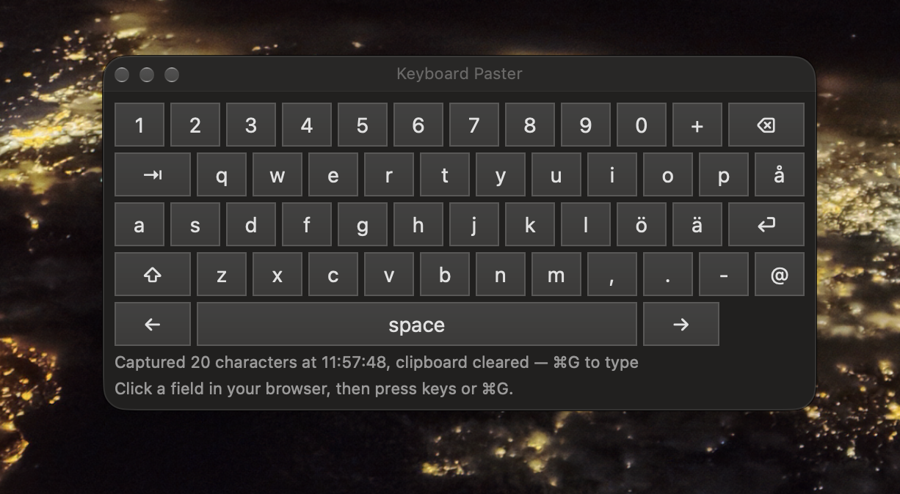

# Keyboard Paster

*In English: [README.en.md](README.en.md)*

**Att blockera inklistring är ingen säkerhetsfunktion. Det försämrar säkerheten.**

Vissa inloggningsformulär vägrar ta emot inklistrad text: VPN-klienter, portaler för fjärråtkomst, bankernas sidor, interna verktyg. Det görs i säkerhetens namn, men effekten blir den motsatta: lösenordshanteraren stängs ute och folk får svagare lösenord.

## Konceptbeviset är en prompt

Lösningen tar texten från urklippet och skriver in den i det aktiva fältet som riktiga tangenttryckningar. Du behöver inte det här repot för att få den. **[PROMPT.md](PROMPT.md) är en prompt du kan ge vilken AI-kodassistent som helst**, för macOS, Windows eller Linux, och du får en egen version. Det är hela poängen: om en enda prompt tar sig förbi spärren stoppar den ingen.

Prompten anger också säkerhetsreglerna: ingen loggning, bara i minnet, inget nätverk, töm urklippet.

Vi har testat den. En AI-agent som aldrig hade sett den här koden fick bara prompten. Den skrev en macOS-app på 258 rader som kompilerade utan fel på första försöket, på under fem minuter. Testet gällde bygget, inte inmatning i ett riktigt fält; det täcker versionen nedan.

Det här repot innehåller en version: **Keyboard Paster**, en macOS-app byggd med en AI-assistent. Den fungerar: testad mot inloggningsrutor i VPN-klienter som vägrar inklistring.



Det här är en nödlösning, ingen åtgärd. Åtgärden är att leverantören slutar blockera inklistring.

### Ett arv till framtiden

Kod åldras med sin plattform. Prompten är inte bunden till någon: ge den till den AI-assistent som finns om fem år, för det system du använder då, och du får en version för den dagen. Här är den i sin helhet, på engelska så att den fungerar med vilken assistent som helst ([PROMPT.md](PROMPT.md) har samma text att kopiera):

```text
Build me a small desktop tool for [macOS / Windows / Linux] that types text into fields that refuse paste.

Use the language and APIs native to that platform, with no third-party dependencies. Keep it to one
source file I can read in a few minutes, plus a build script or build instructions.

What it does:
1. A global hotkey captures the current clipboard text into an in-memory buffer, then clears the
   clipboard.
2. A second global hotkey types the buffer into whatever field has focus, as synthetic keystrokes,
   one character at a time. Send characters as Unicode text, not as key codes, so any keyboard
   layout works.
3. Before typing, wait until the hotkey's modifier keys are released, so the typed text doesn't
   turn into shortcuts.
4. Drop trailing newlines from the buffer so typing never submits the form. Inside the text, a line
   break presses Enter and a tab presses Tab.
5. Pause a few milliseconds between keystrokes, because some apps drop keys that arrive too fast.
6. Show a small status window or tray icon with only the number of characters captured and the
   time of capture, never the text itself.
7. Pick hotkeys that don't clash with common shortcuts, and make them easy to change in the source.
   If a hotkey can't be registered because another app owns it, say so in the status display.
8. Keep the buffer after typing, so it can be typed again, until the next capture, an explicit
   "clear" action or quit.
9. Only one instance may run at a time.

Security requirements, because the buffer is usually a password:
- Never log, print or display the buffer's contents. Send stdout and stderr nowhere.
- Keep the buffer only in memory. Never write it to disk, settings or crash reports.
- No network access of any kind.
- If typing needs a special OS permission (for example Accessibility on macOS), say which one and
  why, and request nothing more.

When you're done, explain how to build and run it, which permission it needs, and how to take that
permission away again.
```

## Varför blockerad inklistring försämrar säkerheten

Ett fält som vägrar inklistring stoppar ingen angripare. Det stoppar personen som loggar in från att använda en lösenordshanterare. Den som måste skriva lösenordet för hand väljer ett som går att skriva: kort, lätt att komma ihåg och återanvänt. Tjänsten som blockerar inklistring får alltså svagare lösenord, inte starkare.

Det här är ingen udda åsikt. De som skriver reglerna håller med:

- **NIST SP 800-63B-4** (USA:s riktlinjer för digital identitet, §3.1.1.2): ”Verifierare SKA tillåta lösenordshanterare och autofyll. Verifierare BÖR låta användare använda funktionen ’klistra in’ när de anger ett lösenord.” Där står också att lösenordshanterare ”har visat sig öka sannolikheten att användare väljer starkare lösenord”. (Vår översättning, [källa](https://pages.nist.gov/800-63-4/sp800-63b.html).)
- **WCAG 2.2, framgångskriterium 3.3.8** (Tillgänglig autentisering, nivå AA): att blockera inklistring i ett inloggningsfält tvingar folk att skriva av lösenordet, och underkänns enligt kriteriet om inget annat sätt erbjuds. ([källa](https://www.w3.org/WAI/WCAG22/Understanding/accessible-authentication-minimum.html))
- **Google Lighthouse** flaggar ”Prevents users from pasting into input fields” som dålig praxis, eftersom ”inklistring av lösenord faktiskt *förbättrar* säkerheten, eftersom det möjliggör lösenordshanterare”. (Vår översättning, [källa](https://developer.chrome.com/docs/lighthouse/best-practices/paste-preventing-inputs).)
- **Troy Hunt** kallade det redan 2014 för ”[The 'Cobra Effect' that is disabling paste on password fields](https://www.troyhunt.com/the-cobra-effect-that-is-disabling/)”: en åtgärd som ska hjälpa säkerheten men gör den sämre.

De vanliga skälen för att blockera inklistring håller inte:

| Påstående | Verklighet |
|---|---|
| ”Det stoppar lösenordsgissning (brute force).” | Angripare använder inte inloggningsformulärets inklistring. De skickar anrop direkt med skript. Begränsning av antal försök och kontospärr stoppar lösenordsgissning; blockerad inklistring gör det inte. |
| ”Lösenordet blir kvar i urklippet.” | Lösenordshanterare tömmer urklippet efter en kort stund, och många fyller i fält utan urklippet. Keyboard Paster tömmer det direkt efter att texten hämtats. |
| ”Folk ska komma ihåg sina lösenord.” | Ett lösenord du kan komma ihåg är ett lösenord en angripare kan gissa. Långa, slumpmässiga, unika lösenord kräver en lösenordshanterare. |

### Det stoppar inte ens någon: AI kan bygga vägen runt

Keyboard Paster skrevs med en AI-kodassistent; committen anger det. Att skriva text som syntetiska tangenttryckningar kräver några få systemanrop, och vilken AI-assistent som helst skriver dem åt den som frågar ([PROMPT.md](PROMPT.md) är allt som behövs). Vilket hinder blockerad inklistring än var en gång, så är det borta.

Det ändrar vad blockeringen faktiskt gör. Den stoppar ingen som vill ta sig förbi. Det den gör är att driva folk mot ett av två utfall, båda sämre än inklistring:

1. **Ett svagt lösenord.** Kort nog att skriva för hand, och oftast återanvänt.
2. **Ett ogranskat hjälpverktyg.** Något som hittats på nätet, eller som en AI skrev åt dem för några minuter sedan, och som sedan får behörigheten Hjälpmedel: den macOS-behörighet som låter en app läsa och styra andra appar, även skriva i dem. Ingen har granskat den koden.

Blockerad inklistring stänger alltså ingen angreppsväg. Den öppnar en, och försämrar säkerheten ännu en gång. De som skulle skyddas lämnar till slut sin känsligaste text till programvara som ingen har granskat. Att klistra in från en lösenordshanterare var det säkrare alternativet, och blockeringen tog bort det.

Det gäller även det här verktyget: läs källkoden innan du ger det behörighet.

## Vad leverantörer bör göra

**Är det fortfarande 2012?** Troy Hunt pekade ut blockerad inklistring redan 2014, och NIST har sagt åt verifierare att tillåta inklistring sedan juni 2017 ([SP 800-63B, §5.1.1.2](https://pages.nist.gov/800-63-3/sp800-63b.html)).

Tillåt inklistring, och märk upp fälten så att lösenordshanterare kan fylla i dem (`autocomplete="current-password"` på webben). I skrivbordsklienter: låt lösenordsfältet ta emot ⌘V och Redigera › Klistra in som vilket textfält som helst, och töm inte urklippet bakom användarens rygg.

## Vad verktyget gör

Keyboard Paster visar ett litet flytande tangentbord som aldrig tar fokus, så markören stannar i fältet du skriver i.

| Kortkommando | Funktion |
|---|---|
| ⌘F | Hämta texten från urklippet till bufferten och töm sedan urklippet |
| ⌘G | Skriv buffertens innehåll som tangenttryckningar i det aktiva fältet |

1. Kopiera lösenordet från din lösenordshanterare (⌘C).
2. Tryck ⌘F. Du hör ett ”tink”, och panelen visar `Captured N characters at <tid>`.
3. Klicka i fältet som blockerar inklistring och tryck ⌘G.

Bufferten finns kvar till nästa ⌘F, så du kan skriva in den flera gånger. Vid inmatningen:

- Avslutande radbrytningar tas bort, så att inmatningen inte trycker Retur och skickar formuläret.
- Radbrytningar inne i texten trycker Retur, och tabbar trycker Tabb.

Du kan också klicka direkt på tangenterna på skärmen (svensk layout). Stänger du panelen avslutas appen.

> ⌘F / ⌘G ersätter Sök / Sök nästa i alla appar medan Keyboard Paster körs.
> För att ändra dem, redigera `registerHotKeys()` i `KeyboardPaster.swift`. Tangentkoderna är `kVK_ANSI_*`; modifierarna är `cmdKey`, `optionKey`, `controlKey` och `shiftKey`.

## Bygga och köra

Kräver macOS 13 eller senare och Xcodes kommandoradsverktyg (`xcode-select --install`).

```sh
git clone https://github.com/inireab/keyboard-paster.git
cd keyboard-paster
./build.sh                               # bygger ~/Applications/KeyboardPaster.app
open ~/Applications/KeyboardPaster.app   # eller starta via Spotlight
```

Appen byggs för din Macs arkitektur och signeras ad hoc på din dator; det finns ingen färdigbyggd nedladdning. När appen startar avslutas en eventuell kopia som redan körs.

## Behörigheten Hjälpmedel

För att skriva tangenttryckningar behövs **Systeminställningar › Integritet och säkerhet › Hjälpmedel › Keyboard Paster**.

- Starta `.app`-paketet med Finder, Spotlight eller `open`. Kör du programfilen inuti den från en terminal frågar macOS efter terminalens behörighet i stället.
- Appen är ad hoc-signerad, så **varje nybygge gör behörigheten ogiltig**. Efter ett nybygge:

  ```sh
  pkill -x KeyboardPaster
  tccutil reset Accessibility local.kbpaster
  open ~/Applications/KeyboardPaster.app   # godkänn frågan, avsluta och öppna igen
  ```

Läs källkoden innan du ger den behörigheten. Det är en enda fil på ungefär 300 rader, och en app som kan skriva tangenttryckningar kan skriva vad som helst.

## Integritet

Bufferten är oftast ett lösenord, därför:

- Ingenting loggas någonsin. Det finns inga loggningsanrop, och stdout/stderr går till `/dev/null`.
- Bufferten finns bara i minnet och skrivs aldrig till disk.
- Panelen visar bara antalet tecken och tidpunkten då texten hämtades.
- Urklippet töms direkt efter att texten hämtats.
- Appen öppnar inga nätverksanslutningar.

Två risker återstår:

- Verktyg som sparar urklippshistorik (Raycast, Alfred, Paste …) kan spara texten när du trycker ⌘C. De flesta lösenordshanterare märker sina kopior så att de verktygen hoppar över dem; vanlig text som kopierats från annat håll har inget sådant skydd.
- Syntetiska tangenttryckningar syns för alla appar som har behörighet att övervaka tangentbordet, precis som vanligt skrivande.

## Begränsningar

Det här är ett konceptbevis, ingen produkt.

- Bara macOS.
- Tecknen skickas som Unicode-text, inte som fysiska tangentkoder. Appar som läser tangentkoder i stället för tecken, till exempel klienter för fjärrskrivbord och virtuella maskiner, kan få fel tecken.
- Varje tecken tar några millisekunder, eftersom vissa webbappar tappar tangenttryckningar som kommer för snabbt. En lång text tar en stund.
- Inte signerad med ett Apple Developer ID och inte notariserad. Du bygger den själv.

## Filer

| Fil | Syfte |
|---|---|
| `PROMPT.md` | Prompten som bygger verktyget på valfri plattform |
| `KeyboardPaster.swift` | Hela appen (AppKit, Carbon-kortkommandon, inmatning via CGEvent) |
| `build.sh` | Kompilerar, skapar `.app`-paketet och signerar det ad hoc |
| `kbpaster.png` | Skärmbild av appen |

## Licens

MIT, se [LICENSE](LICENSE).
